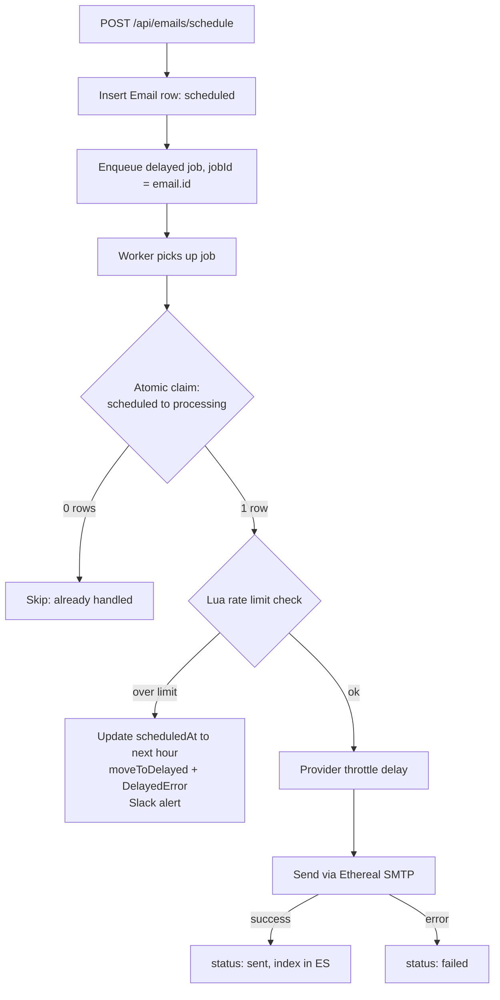
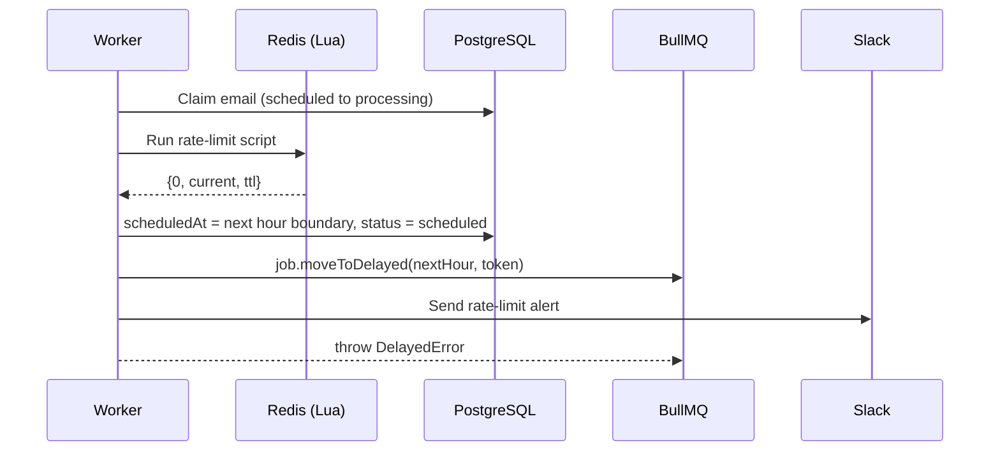
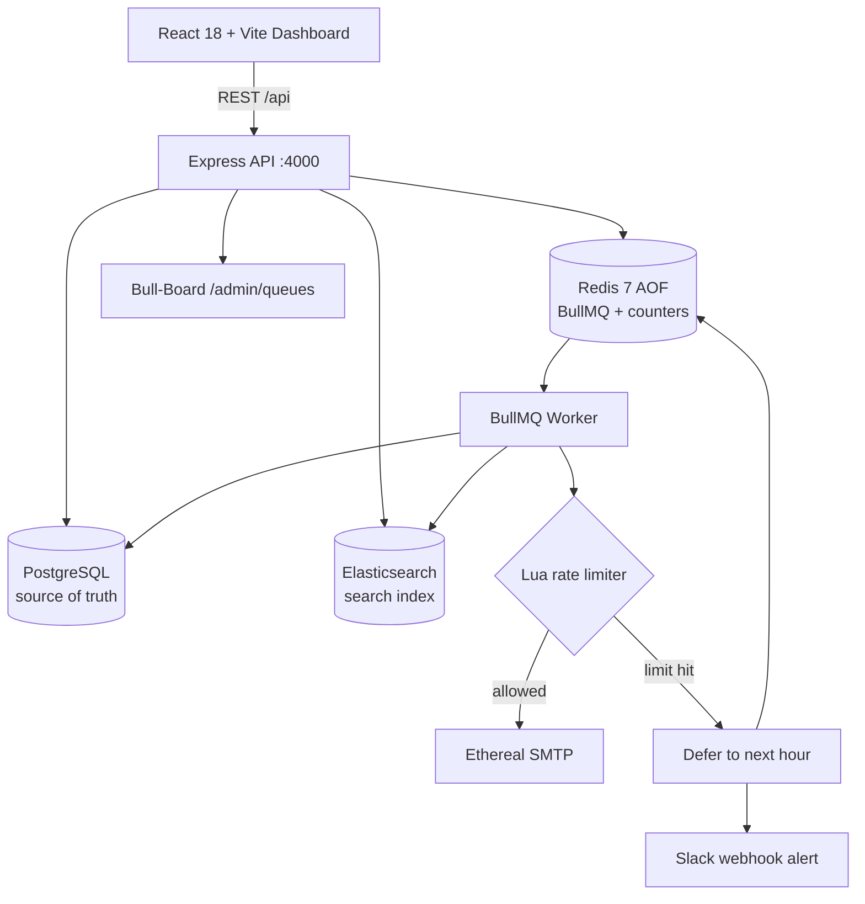

# ReachInbox Email Scheduler Project demonstration

My deployed link from the scratch
https://frontend-rouge-two-96.vercel.app
---
---


[🎥 Full project demontration]
https://github.com/user-attachments/assets/6c1f913d-159d-4524-8618-064dfb100ccb

(This is the main Video) Here i have also used the elastic search in the project.

---
## Screenshots

<!-- Add screenshots: Dashboard, Compose, Scheduled list, Bull-Board, Slack alert -->
Elastic Search


My schedule and executed task


---

## Tech Stack

| Layer | Technologies |
| --- | --- |
| Frontend | React 18, TypeScript, Vite, Tailwind CSS |
| Backend | Node.js, Express, TypeScript, Passport.js (Google OAuth) |
| Queue | BullMQ, Redis 7 (AOF) |
| Database | PostgreSQL 16, Prisma |
| Search | Elasticsearch 8.11 |
| Email | Nodemailer, Ethereal SMTP |
| Monitoring | @bull-board, Slack webhooks |
| Infrastructure | Docker Compose |

---
## Steps to execute my project first cloning it then simultaneously setup the backend frontend along with the Docker , Bull Mq and Redis 

### Prerequisites

- Node.js 18+ and npm
- PostgreSQL 14+, Redis 7+ (local or Docker)
- Elasticsearch 8+ 

### 1. Clone
```bash
git clone https://github.com/Shreyansh123185655/fullstack-email-job-scheduler.git
cd fullstack-email-job-scheduler
```

### 2. Start Infrastructure

**Docker Compose (recommended)**
```bash
docker compose up -d
```
Starts PostgreSQL 16 (`:5432`), Redis 7 with `appendonly yes` (`:6379`), and Elasticsearch 8.11 (`:9200`).

**Local services (Homebrew)**
```bash
brew services start postgresql@14
brew services start redis
redis-cli config set appendonly yes
```

### 3. Run the Backend
```bash
cd backend
npm install
cp .env.example .env
npm run prisma:push
npm run seed
npm run dev
```

| Endpoint | URL |
| --- | --- |
| API | `http://localhost:4000/api` |
| Health | `http://localhost:4000/health` |
| Bull-Board | `http://localhost:4000/admin/queues` | (It also depends on the individual system and the available port system)

### 4. Run the Frontend
```bash
cd frontend
npm install
npm run dev
```
Open `http://localhost:5173`. Vite proxies `/api` to port 4000. From the repo root you can also run `npm run dev:backend` and `npm run dev:frontend`.

---

---

## Architecture
### Email Lifecycle

### Deferral Sequence



## Points that i have kept in my mind while execution and running the project 

#### 1. Zero Cron Jobs and Idempotent Scheduling
#### 2. Restart Resilience
#### 3. Distributed Atomic Rate Limiter (Redis Lua)
#### 4. Provider Throttling
#### 5. Multi-Sender SMTP via Ethereal
#### 6. Elasticsearch Search with Fallback
#### 7. Live BullMQ Dashboard
#### 8. Slack Integration with the real OAuth (google)

---
**As asked in the requirement section of the description shared by the job. Here are the explained terms**

## 1. Ethereal Email & Environmental Variables
Using Nodemailer to send emails but not actually deliver them to an inbox. Each email sent creates a preview link. 
Environmental variables have been used. These are stored within `.env` files which store the config for PostgreSQL, Redis, Authentication, Slack, and the Email Scheduler.
We have set the max number of running jobs to 5, and limited the time between sending each email to 2 seconds. We also have a limit on how many emails can be sent from a sender per hour (15).

## 2. Architecture
When the user schedules an email, the information will be stored within the PostgreSQL database and will be added to BullMQ. We have used Redis to control the delay of emails, meaning we don’t need to use cron jobs or polling.

Email data is stored in PostgreSQL. Jobs are queued using Redis. If a job was interrupted during a restart, it will be restored.

We can run up to 5 jobs at the same time. Redis has been used with Lua scripts to limit how many emails can be sent per hour. Emails that go over the limit will be rescheduled. We have Slack alerts to inform users when the limit has been hit.

## 3. Features
### Backend
- Scheduled emails using BullMQ.
- Data is stored in the PostgreSQL database. Jobs will be restored after a restart.
- Limited to sending a certain amount per hour. Emails will be rescheduled if they go over the limit. Emails can be sent concurrently.
- Monitoring using Bull Board. Search using Elasticsearch. Slack alerts.
- Send emails using Ethereal SMTP with preview links.

### Frontend
- Login using Google OAuth. Developer login included for easy testing.
- Dashboard with email stats, search, and navigation.
- Create emails by adding recipients manually or uploading CSV/TXT files. Duplicates are removed automatically.
- Schedule emails to send now or later.
- View scheduled and sent emails within tables. See status of emails and Ethereal preview links.
- Connect to Slack using OAuth or Webhook. Test notifications directly from the UI.

## 4. Major Design Decisions
- **Persistence & Queueing:** Email information is stored as the source of truth in PostgreSQL, while rapid queueing and scheduling is handled natively by Redis + BullMQ.
- **Atomic Database Updates:** Updates to the database have been made atomically. This prevents race conditions and stops more than one worker from sending the same scheduled email.
- **Graceful Deferral:** Emails that go over the rate limit are smoothly deferred and rescheduled into the next hour block instead of failing.
- **Testing Ease:** The project has been made easier to test and demo by including a developer login bypass and allowing direct Slack Webhook setup.


---
